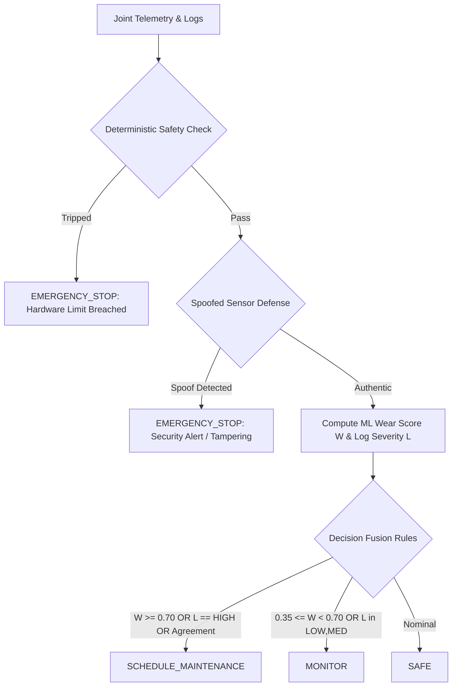

# Technical Explanation: Robotic Arm Joint Health Monitoring System
**Course:** 23IF02 — System Automation (Bonus Challenge)  
**System Architecture:** Multi-Modal Cyber-Physical Health Monitoring & Decision Pipeline

---

## 1. Justification for Immediate-Stop Safety Thresholds

The deterministic immediate-stop thresholds are modeled after an industrial 6-axis articulated manipulator in the 20 kg payload category (e.g., KUKA KR-20 or ABB IRB-2600 class). In automated production environments, functional safety is governed by **ISO 10218-1/2** (Industrial Robot Safety Requirements) and **ISO 13849-1** (Safety-Related Parts of Control Systems, Category 4 / Performance Level e). 

Safety-critical emergency stops must execute with microsecond deterministic guarantees. They must **never** depend on an ML inference cycle, asynchronous bus, or network connection.

| Joint | Metric | Threshold Limit | Engineering & Standards Justification |
| :--- | :--- | :--- | :--- |
| **Shoulder (J1/J2)** | Torque | **175.0 Nm** | Nominal rated torque is 120 Nm. 175 Nm represents ~145% mechanical yield threshold. Beyond this point, cycloidal drive pins and gear teeth experience permanent plastic deformation, shear failure, or servo stall. |
| **Shoulder (J1/J2)** | Temperature | **85.0 °C** | Servomotors use Class F winding insulation (rated to 155 °C internal hot-spot). A surface housing reading of 85 °C corresponds to internal core temperatures > 130 °C, risking irreversible demagnetization of neodymium (NdFeB) rotor magnets. |
| **Shoulder (J1/J2)** | Vibration | **12.0 mm/s RMS** | Based on **ISO 20816-1 / ISO 10816-3 Zone D** ("Unacceptable / Immediate Stop"). Vibration > 12 mm/s signifies severe structural resonance, gear tooth spalling, or catastrophic bearing raceway flaking. |
| **Elbow (J3)** | Torque | **120.0 Nm** | Nominal rated torque is 80 Nm. 120 Nm is the maximum transient flexspline endurance limit for harmonic drive gearboxes. |
| **Elbow (J3)** | Temperature | **85.0 °C** | Identical motor thermal threshold to prevent thermal runaway and grease evaporation. |
| **Elbow (J3)** | Vibration | **11.0 mm/s RMS** | Exceeds Zone D boundary for flexible arm segments, signaling imminent gear tooth fracture or flexspline fatigue. |
| **Wrist (J4/J5/J6)** | Torque | **60.0 Nm** | Nominal rated torque is 35 Nm. Compact wrist cross-roller bearings and bevel gears experience fracture above 60 Nm. |
| **Wrist (J4/J5/J6)** | Temperature | **80.0 °C** | Compact wrist assembly has lower thermal dissipation capacity and tighter bearing clearances; 80 °C prevents thermal seizure. |
| **Wrist (J4/J5/J6)** | Vibration | **10.0 mm/s RMS** | Bearing race disintegration and end-effector chatter limit. |

---

## 2. Decision Logic: Combining ML Wear Predictions & Maintenance Logs

The system combines statistical machine learning with technician field observations using a **Hierarchical Multi-Modal Arbitration Engine**:

### Fusion Mechanics:
1. **Priority 1 (Fail-Safe Hardware Interlock):**  
   If *any* metric exceeds deterministic safety limits, `EMERGENCY_STOP` fires instantly. Zero ML dependency.
2. **Priority 1 (Cyber-Physical Security Interlock):**  
   If the spoof detector flags telemetry tampering, `EMERGENCY_STOP` fires immediately. Operating an arm with falsified feedback invites fatal collisions.
3. **Priority 2 (Multi-Modal Predictive Fusion):**  
   When all signals are physically authentic and within hard safety limits, the engine computes:
   - **Quantitative ML Wear Risk Score ($W \in [0.0, 1.0]$):** Generated by an ensemble Random Forest classifier trained on 160 historical failure cycles, factoring in mechanical power proxies ($\tau \cdot v$) and total vibration power ($\sum v_j^2$).
   - **Qualitative NLP Log Severity Score ($L \in [0.0, 1.0]$):** Derived by domain-specific regex and semantic keyword parsing of unstructured technician notes, filtering shop-floor noise (e.g., coffee cups, cleaning) from genuine mechanical symptoms (e.g., backlash, grinding, metal shavings).
   - **Fused Health Index:**  
     $$FHI = (0.60 \times W) + (0.40 \times L)$$

### State Assignment Criteria:
- **`SCHEDULE_MAINTENANCE`:**
  - $W \ge 0.70$ (ML model detects critical degradation), **OR**
  - $L == \text{"HIGH"}$ (Technician logged severe mechanical symptoms like metal flakes or metallic grinding), **OR**
  - $W \ge 0.50 \land L \in \{\text{"MEDIUM"}, \text{"HIGH"}\}$ (Multi-modal corroboration: numerical wear and technician observation reinforce each other), **OR**
  - $FHI \ge 0.58$.
- **`MONITOR`:**
  - $0.35 \le W < 0.70$ (ML model predicts incipient gear/bearing wear), **OR**
  - $L \in \{\text{"LOW"}, \text{"MEDIUM"}\}$ (Technician logged slight clicking, minor chatter, or play), **OR**
  - $0.25 \le FHI < 0.58$.
- **`SAFE`:**
  - All telemetry strictly nominal, $W < 0.35$, $L \in \{\text{"CLEAN"}, \text{"LOW"}\}$, and no mechanical issues documented.

---

## 3. Spoofed-Sensor Cyber-Physical Defense: Operation, Strengths & Blind Spots

### How It Works
Adversaries or compromised PLCs inject false "nominal" torque values into the telemetry stream to mask severe mechanical binding and prevent safety shutdowns. The defense detects this through **conservation of energy and serial kinematic constraints**:

1. **Thermodynamic-Mechanical Coupling (Energy Dissipation Law):**  
   Mechanical friction and bearing destruction convert kinetic work into heat ($\dot{Q}$) and acoustic structural vibration ($E_{vib}$). When a joint exhibits high vibration ($v_j \ge 6.0\text{ mm/s}$) and high temperature ($T_j \ge 65.0\text{ }^\circ\text{C}$), it is physically impossible for the actuator to draw near-zero or nominal idle torque ($\tau_{shoulder} < 35\text{ Nm}$, $\tau_{elbow} < 25\text{ Nm}$, $\tau_{wrist} < 12\text{ Nm}$). The validator flags this contradiction as `TORQUE_MASKING_THERMODYNAMIC_VIOLATION`.
2. **Serial Kinematic Chain Reaction Equilibrium:**  
   In an open kinematic chain, dynamic torque at distal joints (elbow and wrist) creates reaction moments that *must* be supported by the base shoulder joint ($\tau = J^T F + G(q)$). If distal joints report dynamic activity while the shoulder reports zero or disconnected torque, the defense trips `KINEMATIC_CHAIN_REACTION_VIOLATION`.
3. **Sensor Entropy & Statistical Variance:**  
   Analog strain gauges exhibit stochastic Gaussian noise. Injected constant payloads exhibit zero variance ($\sigma^2 < 10^{-4}$) across consecutive cycles, triggering `STATIC_REPLAY_FROZEN_TORQUE`.

### Attacks Successfully Caught
- **Torque-Masking Covert Sabotage:** Attacker clamps torque to nominal (e.g. 10.5 Nm) while the wrist joint is mechanically binding and overheating.
- **Disconnected / Zero-Value Injection:** Attacker drops torque to 0.0 Nm to mimic an idle state while the arm is accelerating.
- **Asymmetric Single-Sensor Manipulation:** Attacker intercepts the torque fieldbus (e.g., CAN bus message ID) without altering independent accelerometer or thermocouple buses.
- **Static Replay Attacks:** Attacker replays a constant recorded packet.

### System Blind Spots
- **Omniscient Multi-Sensor Coordinated Spoofing:** If an attacker has full mathematical knowledge of the robot's physical model and compromises all three sensor streams simultaneously (falsifying torque, temperature, and vibration to simulate a coherent light-load trajectory), the physical consistency check will not detect the anomaly.
- **Slow Dynamic Drift / Biased Offset Attacks:** If an attacker gradually depresses reported torque by 10–15% over weeks (remaining within plausible nominal distributions) before high friction induces thermal or vibrational runaway, the defense cannot distinguish spoofing from normal mechanical variance until secondary symptoms manifest.
- **Low-Speed Static Binding:** Binding occurring during low-velocity unweighted jog routines produces minimal high-frequency vibration and slow thermal accumulation, creating a window where torque spoofing cannot be verified by thermodynamic coupling alone.
